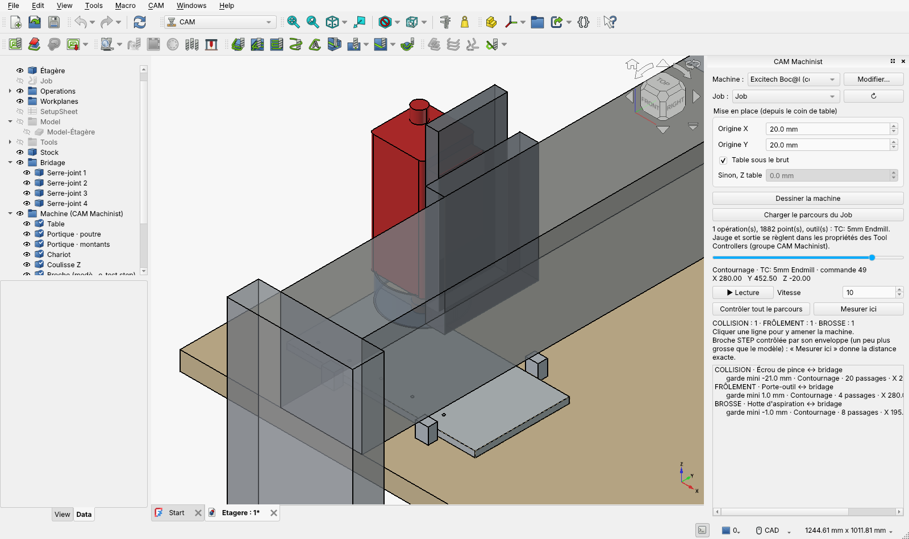
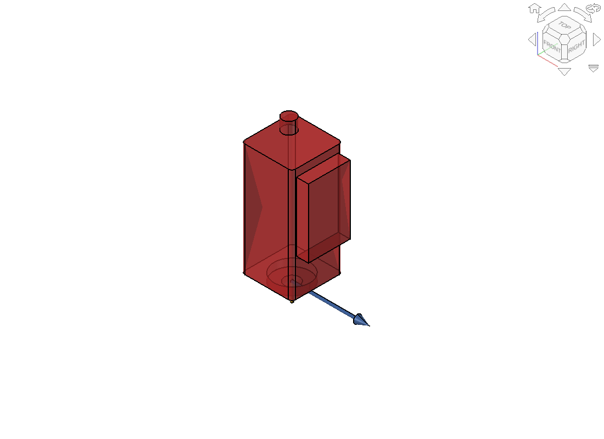

# CAM Machinist

Extension FreeCAD qui ajoute la machine dans l'atelier CAM : le portique, le chariot, la coulisse Z et la broche suivent le parcours d'outil du Job, et un contrôle signale les collisions et les dépassements de course avant d'envoyer le programme à la fraiseuse.

Développée au FabLab Le Boc@l (Centre Social et Socioculturel du Chemillois) pour remettre en service notre fraiseuse Excitech. Elle convient à toute fraiseuse 3 axes à portique : chaque lieu décrit sa machine dans un profil, qu'il peut partager avec d'autres.

## Ce que fait l'extension

- **Machine dans la vue 3D** : table, portique, chariot, coulisse Z, broche, écrou de pince, porte-outil, outil et hotte d'aspiration.
- **Modèle STEP de la broche** : le vrai modèle 3D (fichier du fabricant ou dessin maison) remplace la broche dessinée à partir des cotes. Un assistant l'aligne sur le nez de broche en deux clics.
- **Suivi du parcours** : curseur et lecture animée sur tout le programme, opération et commande affichées.
- **Contrôle de tout le parcours** : outil, écrou, porte-outil, broche, coulisse, chariot, poutre et montants contre la table, les bridages, la pièce finie et le brut, plus les courses X, Y et Z. Un clic sur une alerte amène la machine au point fautif.
- **Mesure exacte** : « Mesurer ici » calcule les distances réelles à la position du curseur, avec le vrai modèle STEP.
- **Profils machine** : cotes et modèle de broche enregistrés une fois pour tous les projets, exportables en `.zip` pour un autre poste ou un autre fablab.

## Installation

FreeCAD 1.0 ou plus récent (testé avec FreeCAD 1.1.1 et 26.3).

**Par le gestionnaire d'extensions (recommandé)**

1. Dans les préférences du gestionnaire d'extensions de FreeCAD (Addon Manager), ajouter un dépôt personnalisé : `https://github.com/urruck/freecad-cam-machinist`, branche `main`.
2. Ouvrir le gestionnaire d'extensions, chercher « CAM Machinist », installer, puis redémarrer FreeCAD.

**À la main**

1. Trouver le dossier des extensions : dans la console Python de FreeCAD (Affichage › Panneaux › Console Python), taper `App.getUserAppDataDir()`. Le dossier `Mod` se trouve dedans, par exemple `~/.local/share/FreeCAD/v1-1/Mod/` sous Linux avec FreeCAD 1.1.
2. Y décompresser l'archive du dépôt (bouton « Code » › « Download ZIP » sur GitHub), puis redémarrer FreeCAD. Le nom du dossier créé dans `Mod` n'a pas d'importance.

Le bouton **CAM Machinist** apparaît dans la barre d'outils de l'atelier CAM, à côté des outils d'inspection, et dans le menu CAM avec **Profils machine…**.

## Utilisation

1. Ouvrir le document qui contient le Job CAM et cliquer sur **CAM Machinist**.
2. **Machine** : choisir le profil, puis **Modifier…** pour saisir les cotes mesurées sur la machine.
3. **Mise en place** : indiquer où se trouve l'origine du Job (le G54) depuis le coin de table. Par défaut, le dessus de table est pris sous le brut.
4. Glisser les serre-joints, cales et tasseaux dans le groupe **Bridage** du document.
5. **Charger le parcours du Job**. Chaque Tool Controller reçoit deux réglages dans ses propriétés (groupe « CAM Machinist ») : la jauge (nez de broche → pointe de l'outil) et la sortie d'outil.
6. **Contrôler tout le parcours**, puis cliquer les alertes pour voir où ça coince.

Gravités affichées :

| Gravité | Sens |
|---|---|
| COLLISION | contact entre la machine et un obstacle |
| COURSE | position hors des courses de la machine |
| FRÔLEMENT | pas de contact, mais garde inférieure à la marge demandée |
| À VÉRIFIER | porte-outil sous le dessus du brut initial (normal dans une poche déjà vidée) |
| BROSSE | brosses de la hotte qui passent sur un bridage ou la table |

## Importer le modèle STEP de la broche

Le fabricant ou le revendeur de la broche fournit souvent un fichier STEP. Sinon, on peut dessiner la broche dans FreeCAD et l'exporter en STEP. Les formats IGES et BREP sont aussi acceptés.

1. **Profils machine…** › **Importer un fichier STEP…**. Un document « Alignement de la broche » s'ouvre avec le modèle et trois repères : le disque gris du nez, l'outil jaune et la flèche bleue côté poutre.
2. Dans la vue 3D, cliquer le **bord circulaire du nez de broche** (la face d'où sort le porte-outil), ou cette face elle-même.
3. **Aligner sur la sélection** : le modèle est redressé, son nez posé sur le disque gris, ses flancs mis d'équerre, et sa fixation tournée vers la poutre.
4. Vérifier, et corriger au besoin avec **Tourner de** (angle libre), **Retourner** ou **Décaler le nez**.
5. **Valider le modèle**, puis **Enregistrer** le profil.

Options :

- *Le modèle comprend aussi la coulisse Z* : pour un fichier qui contient tout l'axe Z, la coulisse dessinée n'est plus ajoutée.
- *Ignorer ce qui dépasse sous le nez* (coché par défaut) : la pince ou le porte-outil inclus dans le fichier sont retirés, puisque l'extension les dessine outil par outil.

Pour le contrôle de tout le parcours, la broche est remplacée par une **enveloppe** : quelques pavés et cylindres verticaux qui contiennent entièrement le modèle (écart de l'ordre de 3 mm sur les côtés). Le contrôle reste rapide et ne manque aucune collision, mais il peut signaler un frôlement qui n'en est pas un, par exemple contre un coin arrondi. **Mesurer ici** tranche alors avec le modèle exact.

## Profils machine

- Le profil fourni « Excitech Boc@l (cotes à mesurer) » contient des **valeurs de départ, pas les cotes réelles** : tant qu'elles ne sont pas mesurées, le contrôle ne garantit rien.
- Les profils personnels sont rangés dans `<dossier utilisateur FreeCAD>/CAMMachinist/machines/`. Un profil personnel de même nom remplace le profil fourni.
- **Exporter (.zip)** / **Importer (.zip)** : un profil voyage avec son modèle de broche.
- Le document garde une copie des cotes : ouvert sur un poste qui n'a pas le profil, il reste utilisable (sans le modèle STEP).
- **Reprendre le tableur de la macro** récupère les cotes saisies dans l'ancienne macro `Excitech_Bocal.FCMacro`.

## Limites

- Machine 3 axes, contrôle 2,5D : les obstacles sont vus du dessus.
- Le brut contrôlé est le brut initial, d'où la gravité « À VÉRIFIER ».
- Le premier déplacement est supposé partir du X0 Y0 du Job. Le mode incrémental (G91) n'est pas suivi.
- Interface en français.

## Contribuer

Remarques, bugs et propositions : [tickets du dépôt](https://github.com/urruck/freecad-cam-machinist/issues). Les profils de machines d'autres lieux (export `.zip`) sont les bienvenus.

Pour diffuser sa propre version depuis un autre dépôt, changer dans `package.xml` l'adresse du dépôt et l'e-mail de la personne qui maintient l'extension.

## Licence

LGPL-2.1-or-later, comme FreeCAD. Voir `LICENSE`.
